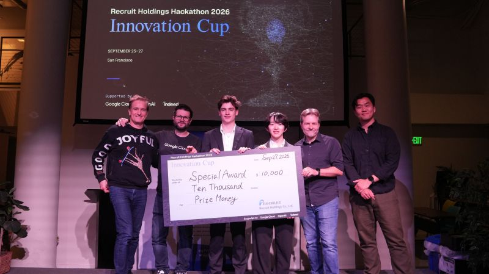

<a href="README.md">English</a> | <strong>日本語</strong>

**[VisionPath](https://visionpath.tech)** &nbsp; / &nbsp; **[LinkedIn](https://www.linkedin.com/in/jake-smith-japan)** &nbsp; / &nbsp; **[お問い合わせ](mailto:jakesmith1447@gmail.com)**

Jake Smith（ジェイク・スミス）です。**立命館大学**でComputer Engineeringを学びながら、**VisionPathの創業者兼CEO**として活動しています。ボストン出身で、現在は大阪を拠点にしています。アクセシビリティ、医療・介護、現場業務をテーマに、ユーザー調査から実装、チームでの成果物の完成まで取り組んでいます。

**自分で実装するプロダクトマネジメント：** インタビューから開発の方向性を決め、チームの進行を支え、その判断を画面やプロトタイプとして形にします。

**VisionPath**では、カメラを活用した移動支援を研究しています。**SprinkMate**では、スプリンクラー施工者が回答の根拠を確認できるAIツールに取り組んでいます。

**動くデモはこちら：** [PENCIL Bridge — 日英対応の人事確認ワークフロー](https://pencil-people-bridge.vercel.app/?lang=ja) · [私の担当とプロダクト上の判断](projects/bridge.ja.md)

**まずはこちらから：** [PENCIL Bridge — 全編ストーリーと写真](projects/bridge.ja.md) · [SprinkMateの開発事例](projects/sprink.ja.md) · [全プロジェクト](projects/INDEX.ja.md) · [技術レビュー](docs/ENGINEERING_REVIEW.ja.md)

立命館大学 **2029年卒業予定** · 英語：母語 · 日本語：日常会話レベル · エンジニアリング・プロダクト領域のインターンシップを希望しています。

**[デモ・動画・実行方法を一覧で見る →](projects/DEMOS.ja.md)**

## 主なプロジェクト

### PENCIL Bridge · 社員インタビューから日英対応のプロトタイプまで、10日間の開発

**PENCIL（株式会社ペンシル） · 九州大学QREC Venture Life Challenge**

**福岡のPENCIL（株式会社ペンシル）**でのインターンシップでは、チームで**10件の社員インタビュー**を行い、**日本語・英語に対応した人事向け確認支援プロトタイプ**を開発しました。人事・エンジニアリング部門の意見を取り入れながら進め、私は**プロダクトの方向性、プロトタイプ実装、技術デモ**を主導しました。九州大学QREC Venture Life Challengeを通じて、Takeshi Yamamoto、Sydney Magnolia Tjandraと協働しました。

10日間で、調査、動くデモ、会社からのフィードバック、財務試算を含む最終発表までを形にしました。プロトタイプでは、人事が元の記録を確認し、フォローのための質問を準備できます。最終判断は人が行う設計です。

**[10日間の全編ストーリーと写真を見る →](projects/bridge.ja.md)** · [日英対応のデモを試す](https://pencil-people-bridge.vercel.app/?lang=ja) · [コードと技術詳細](https://github.com/Jsmitty78/pencil-people-bridge)

**[九州大学へのピッチデックを見る](https://github.com/Jsmitty78/pencil-people-bridge/blob/main/docs/media/deliverables/pencil-bridge-kyushu-pitch-deck.pdf)** · **[当時の人事向けデモ動画を見る](https://pencil-people-bridge.vercel.app/watch?lang=ja)**

ペンシルの人事スーパーバイザーに、10日間でつくったMVPを実際に試していただきました。私たちは会社でのシステム開発を支援し、2026年11月時点でも、更新された社内版が使われています。[全編では、MVP、大学への成果物、その後の展開を紹介しています](projects/bridge.ja.md#our-pitch-deck-and-product-demo)。

*Next.js · React · TypeScript · IndexedDB · 任意で利用するローカルOllama分析*

### 受賞したハッカソンプロジェクト

<table>
<tr>
<td width="50%" valign="top">

<h3><a href="projects/sprink.ja.md">SprinkMate</a></h3>

<strong>特別賞 · Recruit Holdings Innovation Cup</strong>

スプリンクラー施工者向けのAI現場支援ツール。質問し、参照情報を読み、次の作業を確認できます。

<strong>私の担当：</strong>顧客インタビュー、プロダクトの方向性、ピッチ。その後はモバイル版の質問機能のUX、音声入力、エラー時の処理にも取り組みました。

React · TypeScript · Hono · SQLite · 情報検索

<a href="projects/sprink.ja.md">開発事例</a> · <a href="docs/ENGINEERING_REVIEW.ja.md#start-with-sprink">コードとテスト</a>
</td>
<td width="50%" valign="top">

<h3><a href="https://github.com/Jsmitty78/Pathway-Oxford1stPlaceHackathon/blob/main/README.ja.md">Pathway</a></h3>

<strong>優勝 · Oxford Venture Hackathon</strong>

スマートフォンと、その場で工夫して組み立てた歩行器を使い、チームで36時間かけて開発したプロトタイプです。公開リポジトリでは、当時の映像・コードと、再構築したデモを区別して掲載しています。

<strong>私の担当：</strong>ユーザー調査、実機プロトタイプの統合、テスト、ピッチ。チームで32件の街頭インタビューを実施しました。

Python · JavaScript · コンピュータービジョン · ハードウェア

<a href="https://github.com/Jsmitty78/Pathway-Oxford1stPlaceHackathon/blob/main/docs/HACKATHON_STORY.ja.md">開発ストーリー</a> · <a href="https://github.com/Jsmitty78/Pathway-Oxford1stPlaceHackathon#original-hackathon-footage">当時のデモ</a>
</td>
</tr>
</table>

### 大学でのエンジニアリング

<table>
<tr>
<td width="50%" valign="top">
<h3><a href="projects/hospital-finder.ja.md">PBL 3 · CarePath Navigator</a></h3>

<strong>立命館大学 · Hospital Finder</strong>

距離、推定待ち時間、対応言語、診療分野を一つの画面で比較できる病院検索インターフェースです。

<strong>私の担当：</strong>プロジェクト管理、フロントエンドの大部分、バックエンドの一部、アーキテクチャの文書化。

React · TypeScript · Leaflet · システム設計

<a href="projects/hospital-finder.ja.md">開発事例</a> · <a href="https://daitera1.github.io/PBL3-Group-D/">チームの技術資料</a>

ポートフォリオのデモでは、事前に用意した病院データとサンプルの予測値を使用しています。

</td>
<td width="50%" valign="top">
<h3><a href="projects/pbl4.ja.md">PBL 4 · 複数プロジェクターの映像合成</a></h3>

<strong>2台のプロジェクターで、一つのワイド映像を。</strong>

左右のプロジェクター用の画像を生成し、ガンマ補正したアルファマスクで重なり部分を滑らかにつなぐPythonアプリケーションです。

<strong>私の担当：</strong>12人のチームのリード、開発と文書化の調整、プロジェクターの実機設置のサポート。

Python · OpenCV · NumPy · UML · Jira

<a href="projects/pbl4.ja.md">開発事例</a> · <a href="https://github.com/daitera1/PBL4-G1">チームのリポジトリ</a> · <a href="https://github.com/daitera1/PBL4-G1/tree/main/Development">コードと実行手順</a>

実機での投影結果を見る

 

</td>
</tr>
</table>

### 研究・インターンシップ

<table>
<tr>
<td width="50%" valign="top">
<h3><a href="projects/visionpath.ja.md">The Shaky Walker Effect</a></h3>

<strong>AROB 2027 · 発表採択 · 共著者</strong>

歩行器の動きは、リアルタイムの物体検出にどのような影響を与えるのか。歩行に伴うカメラの揺れと、検出を安定させるための手法を研究しています。

<strong>論文：</strong>Steadying the Shaky Walker: Benchmarking and Mitigating Gait-Induced Camera Motion for Real-Time Object Detection.

コンピュータービジョン · カメラの揺れ · 移動支援

<a href="projects/visionpath.ja.md">研究概要と現在の状況</a>

研究は進行中です。発表採択と論文の出版は別であり、研究コードと作業メモは非公開です。

</td>
<td width="50%" valign="top">
<h3><a href="projects/bridge.ja.md">PENCIL Bridge</a></h3>

<strong>プロダクト・デモ開発リード · 九州大学QRECインターンシップ</strong>

ペンシルのエンジニアと人事からの意見をもとに開発した、日英対応の業務記録確認ツール。根拠となる記録を読み、曖昧な指示を見つけ、人が行うフォローを支援します。

<strong>私の担当：</strong>Venture Life Challengeのインターンシップで、プロダクトの方向性、実装、技術デモを担当。

日英対応ワークフロー · 人事支援ツール · プロダクト開発

<a href="https://pencil-people-bridge.vercel.app/?lang=ja"><strong>デモを試す</strong></a> · <a href="projects/bridge.ja.md">開発事例</a> · <a href="https://github.com/Jsmitty78/pencil-people-bridge">ソースコード</a>

</td>
</tr>
</table>

### 医療・介護を支える技術

<table>
<tr>
<td valign="top">
<h3><a href="projects/memorypath.ja.md">MemoryPath</a></h3>

<strong>大阪AIハッカソン · Transpose Platform × 立命館 × OUVC c0mpiled</strong>

YC Request for Startupsのテーマをもとに、看護師が認知症ケアの情報を確認しやすくすることを目指しました。ケア記録や観察内容から根拠付きの提案をつくり、看護師が確認・編集・承認できる仕組みです。

<strong>私の担当：</strong>Yu Yoshimutaとともに、フロントエンド開発、インタビュー、ワークフロー設計を担当。

Next.js · React · TypeScript · 構造化されたAI出力 · 根拠の検証

<a href="projects/memorypath.ja.md">開発事例</a> · <a href="https://github.com/Jsmitty78/MemoryPath">ソースコード</a> · <a href="https://github.com/Jsmitty78/MemoryPath-original-hackathon">ハッカソン当時のバージョン</a>

プロトタイプの画面を見る

 

合成データを使用したプロトタイプです。現在のリポジトリには、ハッカソン後の開発も含まれます。

</td>
</tr>
</table>

[全プロジェクトと関連資料を見る](projects/INDEX.ja.md)。

## コードと検証

**[技術レビュー](docs/ENGINEERING_REVIEW.ja.md)** · **[検証の再現手順](docs/VERIFICATION.ja.md)**

| Sprink | MemoryPath | Pathway |
| :--- | :--- | :--- |
| **フロントエンドテスト38件** · 音声入力とリクエスト失敗時の復旧を確認 | **テスト58件** · 根拠の確認とプロフィール承認 | **テスト27件** · 再構築した危険検出・転倒イベントのロジック |

*2026年11月13日に検証。[検証範囲と制約](docs/VERIFICATION.ja.md)。*

## 短時間で確認できる資料

| プロジェクト | プロダクト・リーダーシップ面の記録 | 技術面の記録 |
| :--- | :--- | :--- |
| PENCIL Bridge | [社員からのフィードバックとインターンシップのストーリー](projects/bridge.ja.md) | [型を定義した検出APIと確認画面](https://github.com/Jsmitty78/pencil-people-bridge) |
| CarePath Navigator | [89件の回答に基づく調査とチームの役割](projects/hospital-finder.ja.md) | [フロントエンド、順位付けロジック、アーキテクチャ](projects/hospital-finder.ja.md#implementation-map) |
| PBL4 | [12人のチームの進行・調整記録](projects/pbl4.ja.md) | [2種類のプロジェクター実装と写真](https://github.com/daitera1/PBL4-G1/tree/main/Development) |
| Shaky Walker | [採択された研究と著者情報](projects/visionpath.ja.md) | カメラの揺れの評価とトラッキングに関する研究 |

## 仕事の進め方

**課題を理解する → チームでつくる → 人に試してもらう → 成果を記録する。**

| ソフトウェア・AI | システム・開発推進 |
| :--- | :--- |
| Python、TypeScript、JavaScript、Java | Raspberry Pi、ESP32、カメラ、RGB-Dセンシング |
| React、Next.js、Node.js、Hono、Flask | ユーザー調査、要件定義、プロトタイピング |
| OpenCV、YOLO、構造化LLM出力、情報検索 | テスト、CI、UML、Jira、技術文書 |

## 受賞歴

- **優勝** — Oxford Venture Hackathon 2026
- **特別賞／チーム賞金10,000米ドル** — Recruit Holdings / Indeed Innovation Cup、サンフランシスコ
- **優勝** — MIT Blueprint Hackathon 2024
- **Osaka Life Science Nexus Award** — ACCJ Health Tech Pitch 2026
- **オーディエンス賞** — Rocket Pitch Kansai 2025

GitHubでの活動

 
<picture>
  <source media="(prefers-color-scheme: dark)" srcset="https://raw.githubusercontent.com/Jsmitty78/Jsmitty78/output/github-contribution-grid-snake-dark.svg">
  
</picture>

---

**役立つものを、一緒につくりたいと思っています。** エンジニアリング、プロダクト、AI、イノベーションに関わる機会を探しています。

[LinkedIn](https://www.linkedin.com/in/jake-smith-japan) · [メール](mailto:jakesmith1447@gmail.com) · [VisionPath](https://visionpath.tech)

[オリジナル動画ファイル（変更せず保存）](https://github.com/Jsmitty78/pencil-people-bridge/blob/main/docs/media/deliverables/pencil-bridge-hr-demo.mp4)
