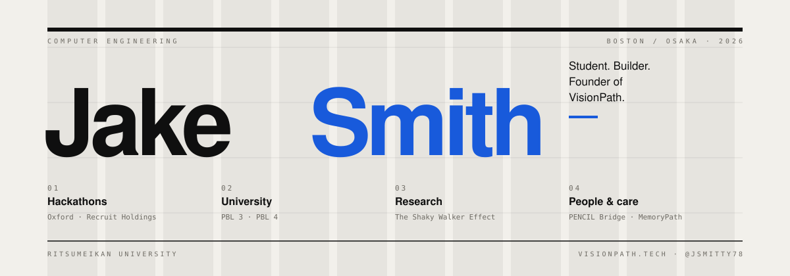
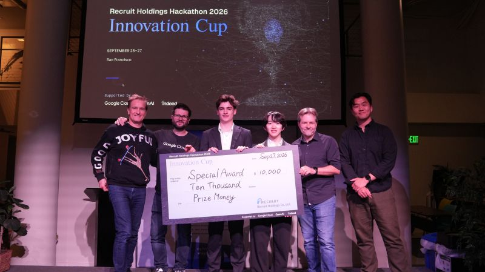

**[LinkedIn](https://www.linkedin.com/in/jake-smith-japan)** &nbsp; / &nbsp; **[VisionPath](https://visionpath.tech)** &nbsp; / &nbsp; **[Email](mailto:jakesmith1447@gmail.com)**

I'm Jake, a Computer Engineering student at **Ritsumeikan University** and the founder of **VisionPath**. Originally from Boston, now in Osaka. I work on software and physical prototypes for accessibility, healthcare, and people working in the field.

## Selected projects

<table>
<tr>
<td width="50%" valign="top">

<h3>Pathway</h3>

<strong>1st Place · Oxford Venture Hackathon</strong>

A 36-hour assistive-mobility prototype built with a smartphone and an improvised walking frame.

<strong>My part:</strong> user research, physical integration, testing, and pitching.

<a href="https://github.com/Jsmitty78/Pathway-Oxford1stPlaceHackathon/blob/main/docs/HACKATHON_STORY.md">Build story</a> · <a href="https://github.com/Jsmitty78/Pathway-Oxford1stPlaceHackathon#original-hackathon-footage">Original demos</a>

</td>
<td width="50%" valign="top">

<h3>SprinkMate</h3>

<strong>Special Prize · Recruit Holdings Innovation Cup</strong>

An AI field assistant for sprinkler fitters, with references users can inspect before deciding their next step.

<strong>My part:</strong> customer interviews, product direction, pitching, and later mobile experience improvements.

<a href="projects/sprink.md">Case study</a> · <a href="docs/ENGINEERING_REVIEW.md#start-with-sprink">Engineering notes</a>

</td>
</tr>
</table>

<table>
<tr>
<td width="50%" valign="top">
03 / PBL 3 · Ritsumeikan
<h3><a href="projects/hospital-finder.md">CarePath Navigator</a></h3>

Compare hospitals by distance, waiting time, language, and specialty.

Team leadership, frontend development, and architecture documentation.

React · TypeScript · Leaflet

<a href="projects/hospital-finder.md">Explore project →</a>

</td>
<td width="50%" valign="top">
04 / PBL 4 · Ritsumeikan
<h3><a href="projects/pbl4.md">Multi-projector blending</a></h3>

Two projectors displaying one continuous image.

Project management for a 12-person team and practical projector setup.

Python · OpenCV · NumPy

<a href="projects/pbl4.md">Explore project →</a>

</td>
</tr>
<tr>
<td width="50%" valign="top">
05 / Research · AROB submission
<h3><a href="projects/visionpath.md">The Shaky Walker Effect</a></h3>

Studying how walker-induced camera motion affects object detection.

Camera-based assistive-mobility research; methods and current status in the overview.

Computer vision · Camera motion

<a href="projects/visionpath.md">Explore project →</a>

</td>
<td width="50%" valign="top">
06 / Kyushu University internship
<h3><a href="projects/bridge.md">PENCIL Bridge</a></h3>

Bilingual workplace-record review for HR.

Product direction, implementation, and technical demonstration.

Product development · Workplace tools

<a href="projects/bridge.md">Explore project →</a>

</td>
</tr>
<tr>
<td colspan="2" valign="top">
07 / Osaka · Transpose Platform AI Hackathon
<h3><a href="projects/memorypath.md">MemoryPath</a></h3>

AI-assisted dementia-care handoffs with evidence-linked proposals and nurse review.

Frontend development, interviews, and care workflow design.

Next.js · TypeScript · Structured AI output

<a href="projects/memorypath.md">Explore project →</a>

</td>
</tr>
</table>

### Tools & experience

**Software:** Python · TypeScript · JavaScript · React · OpenCV  
**Hardware & teamwork:** Raspberry Pi · Cameras · User research · Prototyping · Project management

[Engineering review](docs/ENGINEERING_REVIEW.md) · [Verification notes](docs/VERIFICATION.md)

---

**Open to engineering and product internships.**  
Osaka, Japan · Native English · Conversational Japanese · Expected graduation: 2029

Header adapted from the <a href="https://github.com/beydemirfurkan/awesome-github-profile/tree/main/templates/11-swiss-brutalist/swiss-grid">Swiss Grid template</a> by Awesome GitHub Profile contributors.

<!--
Template attribution:
MIT License
Copyright (c) 2026 Awesome GitHub Profile contributors

Permission is hereby granted, free of charge, to any person obtaining a copy
of this software and associated documentation files (the "Software"), to deal
in the Software without restriction, including without limitation the rights
to use, copy, modify, merge, publish, distribute, sublicense, and/or sell
copies of the Software, and to permit persons to whom the Software is
furnished to do so, subject to the following conditions:

The above copyright notice and this permission notice shall be included in all
copies or substantial portions of the Software.

THE SOFTWARE IS PROVIDED "AS IS", WITHOUT WARRANTY OF ANY KIND, EXPRESS OR
IMPLIED, INCLUDING BUT NOT LIMITED TO THE WARRANTIES OF MERCHANTABILITY,
FITNESS FOR A PARTICULAR PURPOSE AND NONINFRINGEMENT. IN NO EVENT SHALL THE
AUTHORS OR COPYRIGHT HOLDERS BE LIABLE FOR ANY CLAIM, DAMAGES OR OTHER
LIABILITY, WHETHER IN AN ACTION OF CONTRACT, TORT OR OTHERWISE, ARISING FROM,
OUT OF OR IN CONNECTION WITH THE SOFTWARE OR THE USE OR OTHER DEALINGS IN THE
SOFTWARE.
-->
