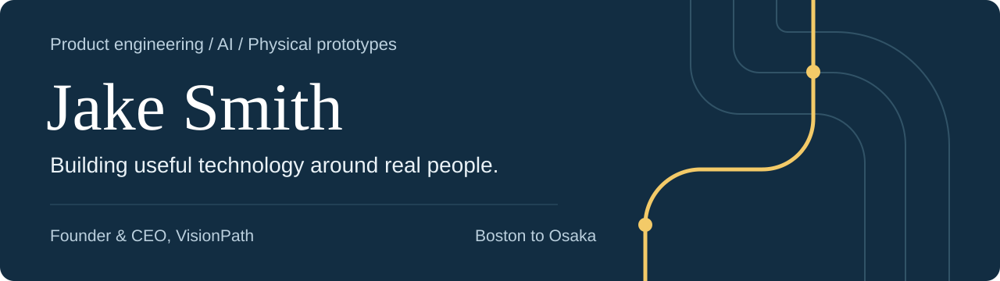
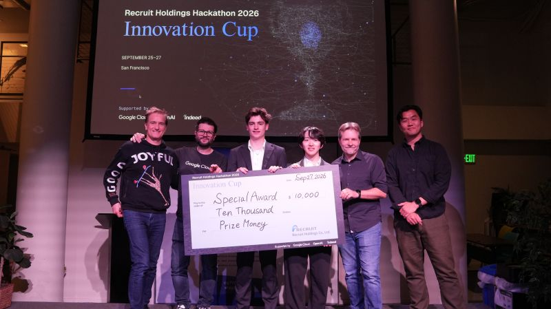

**[VisionPath](https://visionpath.tech)** &nbsp; / &nbsp; **[LinkedIn](https://www.linkedin.com/in/jake-smith-japan)** &nbsp; / &nbsp; **[Get in touch](mailto:jakesmith1447@gmail.com)**

I'm Jake, a Computer Engineering student at **Ritsumeikan University** and the **Founder & CEO of VisionPath**. Originally from Boston, now based in Osaka. I build software and physical prototypes for accessibility, healthcare, and field work—from talking with users to getting a working demo into their hands.

Currently building **assistive mobility technology at VisionPath** and **reviewable AI tools for sprinkler fitters with Sprink**.

## Selected work

<table>
<tr>
<td width="50%" valign="top">

<h3><a href="https://github.com/Jsmitty78/Pathway-Oxford1stPlaceHackathon">Pathway</a></h3>

<strong>1st Place · Oxford Venture Hackathon</strong>

A smartphone and an improvised walking frame, built into an obstacle-detection and fall-alert prototype in 36 hours.

<strong>My work:</strong> user research, physical prototype integration, testing, and pitching. Our team conducted 32 street interviews.

Python · JavaScript · Computer vision · Hardware

<a href="https://github.com/Jsmitty78/Pathway-Oxford1stPlaceHackathon/blob/main/docs/HACKATHON_STORY.md">Build story</a> · <a href="https://github.com/Jsmitty78/Pathway-Oxford1stPlaceHackathon#original-hackathon-footage">Original demos</a>

</td>
<td width="50%" valign="top">

<h3><a href="projects/sprink.md">Sprink</a></h3>

<strong>2nd Place · $10,000 team Special Prize</strong>

An AI field assistant for sprinkler fitters: ask a question, inspect the reference, and review the next step.

<strong>My work:</strong> customer interviews, product direction, pitching, and later mobile Ask UX, voice input, and failure handling.

React · TypeScript · Hono · SQLite · Retrieval

<a href="projects/sprink.md">Case study</a> · <a href="projects/sprink-source/">Explore the code</a>

</td>
</tr>
</table>

### [PBL4 · Multi-projector image blending](projects/pbl4.md)

**Two projectors. One wide image. A 12-person engineering team.**

A Python application that prepares left and right projector images and applies gamma-corrected alpha masks to the overlap. The repository includes both a baseline and a gamma-corrected implementation, alongside the team's demonstration photos and final presentation.

**My role:** project manager, coordinating Development, Documentation, and Management; organizing Jira tasks, team check-ins, shared resources, and the final handover. I also helped with the practical projector setup.

`Python` `OpenCV` `NumPy` `UML` `Jira` `Technical documentation`

[Project overview](projects/pbl4.md) · [Team repository](https://github.com/daitera1/PBL4-G1) · [Code & run guide](https://github.com/daitera1/PBL4-G1/tree/main/Development) · [Final presentation](https://github.com/daitera1/PBL4-G1/tree/main/Presentation)

### More projects

| Project | What I worked on |
| :--- | :--- |
| **[CarePath Navigator / Hospital Finder](projects/hospital-finder.md)** | Led the PBL3 team and built much of the frontend for comparing hospitals by distance, waiting time, language, and specialty. React, TypeScript, Leaflet; seeded portfolio demo. |
| **[MemoryPath](projects/memorypath.md)** | Frontend, interviews, and workflow design for a dementia-care handoff prototype with evidence-backed proposals and nurse approval. Built with Yu at the Transpose Platform AI Hackathon. [Code](https://github.com/Jsmitty78/MemoryPath). |
| **[People Bridge](projects/bridge.md)** | Product definition and prototype development for an HR tool that organizes records and prepares follow-up questions. Anonymized QREC Venture Life Challenge case study. |

## How I work

**Understand the problem → build with the team → test with people → document the result.**

| Software & AI | Systems & delivery |
| :--- | :--- |
| Python, TypeScript, JavaScript, Java | Raspberry Pi, ESP32, cameras, RGB-D sensing |
| React, Next.js, Node.js, Hono, Flask | User research, requirements, prototyping |
| OpenCV, YOLO, structured LLM output, retrieval | Testing, CI, UML, Jira, technical documentation |

## Recognition

- **1st Place** — Oxford Venture Hackathon 2026
- **2nd Place / $10,000 team Special Prize** — Recruit Holdings / Indeed Innovation Cup, San Francisco
- **1st Place** — MIT Startup Hackathon 2024
- **Osaka Life Science Nexus Award** — ACCJ Health Tech Pitch 2026
- **Audience Award** — Rocket Pitch Kansai 2025

Contribution activity

 
<picture>
  <source media="(prefers-color-scheme: dark)" srcset="https://raw.githubusercontent.com/Jsmitty78/Jsmitty78/output/github-contribution-grid-snake-dark.svg">
  
</picture>

---

**Let's build something useful.** Open to engineering, product, AI, and innovation opportunities.

[LinkedIn](https://www.linkedin.com/in/jake-smith-japan) · [Email](mailto:jakesmith1447@gmail.com) · [VisionPath](https://visionpath.tech)
