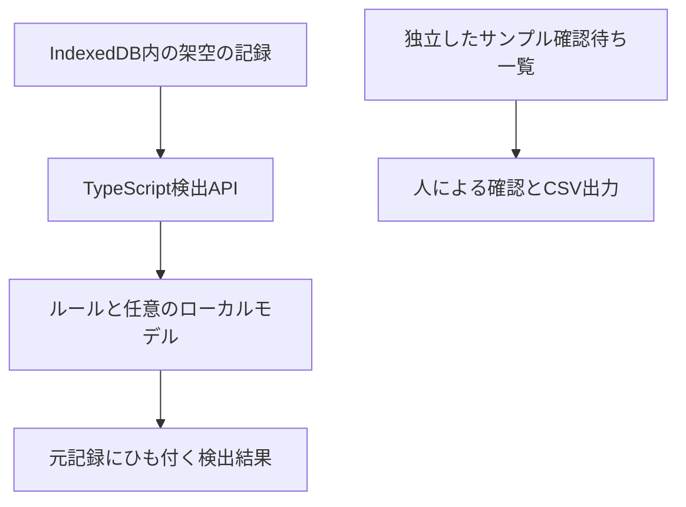

<a href="bridge.md">English</a> | <strong>日本語</strong>

# PENCIL Bridge

**人事業務を支援するプロトタイプ · 九州大学QREC Venture Life Challenge**

九州大学QREC Venture Life Challenge 2026の一環として、PENCIL（株式会社ペンシル）でのインターンシップ中に開発しました。学生チームによるプロトタイプであり、ペンシルの公式製品ではありません。

[公開リポジトリ](https://github.com/Jsmitty78/pencil-people-bridge) · [デモを試す](https://pencil-people-bridge.vercel.app)

[プロフィールに戻る](../README.ja.md)

## 私たちの10日間の開発

**社員へのインタビューから、日本語・英語に対応したプロトタイプ、最終発表まで。ペンシルの人事・エンジニアリング部門から意見をいただきながら取り組みました。**

私は、九州大学の**QREC Venture Life Challenge 2026**を通じて、福岡の**PENCIL（株式会社ペンシル）**で、**Takeshi Yamamoto**、**Sydney Magnolia Tjandra**とともに10日間、PENCIL Bridgeの開発に取り組みました。プロダクトの方向性を定め、プロトタイプとデモの開発を主導し、技術面の成果物をまとめる役割を担いました。

*社内エンジニアリング部門、人事スーパーバイザー2名、エンジニアリングディレクターとの検討。プロトタイプを見せながら、実際の業務にどう組み込めるかを話し合いました。*

[日英対応のデモを試す](https://pencil-people-bridge.vercel.app) · [技術構成を見る](https://github.com/Jsmitty78/pencil-people-bridge/blob/main/README.md#architecture) · [インターンシップの記録](https://github.com/Jsmitty78/pencil-people-bridge/blob/main/docs/PROJECT_ARCHIVE.md)

## 10日間で形にしたこと

社内のコミュニケーションに関する課題を社員の方々に聞くところから始め、10日間で日本語と英語に対応したプロトタイプを発表できるところまで進めました。私が実装とデモを主導し、TakeshiとSydneyが調査、技術面のサポート、デザイン、事業面の検討を担いました。それぞれの仕事をつなげることで、アイデアを説明し、実際に動かして見せられる形にしました。

| 取り組み | 最終的に形にしたもの |
| --- | --- |
| 課題の理解 | 人事、管理職、コンサルタント、エンジニアを対象とした10件の社員インタビュー。 |
| 開発方針の決定 | 初期の3案を人事の方々と検討し、業務上の問題を確認するワークフローに絞り込み。 |
| プロトタイプの開発 | 日英対応の画面、架空の10案件と40件の元記録、根拠付きの検出結果、それとは独立した確認待ち一覧のデモ。 |
| 企業との協働 | 社内エンジニアリング部門、人事スーパーバイザー2名、エンジニアリングディレクターとのプロトタイプ検討。 |
| 成果の共有 | 字幕付きデモ、財務試算、次のパイロット導入に向けた提案、8月29日の最終発表。 |

## 福岡に行こうと思った理由

福岡に行ったのは、自分を新しい環境に置いて挑戦したかったからです。普段は関西で生活していて、九州に行くのは初めてでした。現地に知り合いはいませんでしたが、だからこそ、自分からつながりをつくることを目標にしました。新しい人と出会い、企業の中でプロジェクトに取り組み、知らない場所で自分に何ができるかを試す夏にしたいと思っていました。

ペンシルのオフィスは、最初から印象的でした。創造性が感じられる開放的な空間で、エンジニアとコンサルタントが近い距離で働いているのを見るのが楽しかったです。社員の方々に話を聞き、アイデアを試し、滞在中に実際に何かをつくれることにわくわくしていました。

<table>
<tr>
<td width="50%"></td>
<td width="50%"></td>
</tr>
<tr>
<td>福岡のペンシルのオフィスにて。</td>
<td>Venture Life Challengeで訪れた九州大学にて。</td>
</tr>
</table>

予算はかなり限られていたので、小さなカプセルホテルやインターネットカフェを転々としながら、少しずつ街に慣れていきました。そのうち、現地でできた友人が泊まる場所を提供してくれるようになりました。滞在を続けるためには工夫も必要でしたが、新しい人と出会い、新しいプロジェクトに関われることがうれしくて、毎日が楽しみでした。

<table>
<tr>
<td width="35%" valign="middle" align="center"></td>
<td width="65%" valign="middle"></td>
</tr>
<tr>
<td>限られた予算で滞在を続ける中で利用したカプセルホテルの一つ。</td>
<td>友人とお寺と美しい滝を訪ねた日。オフィスを離れ、九州を楽しむ時間も大切な思い出になりました。</td>
</tr>
</table>

特に心に残っているのは、ゲームセンターであるご家族と出会ったことです。街を案内してくださり、家族の一員のように接してくれて、数日間泊めていただくことまでありました。誰も知らない場所に来たはずが、日常の中に迎え入れてくれる人たちに出会えた。その温かさには、今でも感謝しています。

*温かく迎えてくださったご家族と囲んだ食卓。*

*オフィスの外でも、新しい友人と思い出が増えていきました。*

福岡も、初めて知る九州も大好きになりました。福岡のスタートアップコミュニティは温かく、出会った人たちのおかげで、もっといろいろな場所を見てみたいと思うようになりました。休みの日には数日かけて熊本にも足を運び、震災復興のボランティアに参加しました。初めて訪れる土地を知るだけでなく、滞在している間に自分にできることでも貢献したいと思っていました。

*プロジェクトの合間に、九州のさまざまな場所を訪ねました。*

帰る頃には、誇りに思えるプロジェクトだけでなく、新しい友人とたくさんの思い出ができていました。知り合いのいない場所に行ったことで、自分から声をかけ、質問し、参加するようになりました。その好奇心はペンシルでの仕事にもつながりました。何をつくるかを決める前に、まず社内の人たちの話を聞く必要があったからです。

## まず、現場で働く人たちの話を聞く

与えられた課題は、企業の成長、人材の多様化、AIによる働き方の変化に関わる組織の問題を理解することでした。何を開発するかを決める前に、社内でコミュニケーションがどのように行われているのかを知る必要がありました。

私たちは、人事、管理職、コンサルタント、エンジニアを対象に**10件のインタビュー**を行い、日本人社員と海外出身の社員の両方に話を聞きました。情報をどこで共有しているか、指示が曖昧なときに何が起きるか、問題が生じたあと人事にどのように伝わるかを確認しました。

私にとって、日本語でのインタビューは簡単ではありませんでした。まだ学んでいる途中だったので、言語面ではAIツールにも助けてもらいました。相手が話してくれる悩みに耳を傾けながら、日本語を使い続ける経験になりました。また、各チームがどのように情報を共有し、仕事について話し合うのかを見て、日本企業の部門会議の進め方も学びました。プロダクトの開発と同じくらい、私にとって大切な経験でした。

*エンジニアの方の悩みを聞き、コミュニケーションが業務にどう影響しているのかを理解するためのインタビュー。*

繰り返し聞かれたのは、一つの意思決定の経緯が、会議、Chatworkのスレッド、Backlogの課題、Boxの資料、口頭での会話などに分散していることでした。あとから確認する人には結果だけが見え、そこに至った背景がわからない場合がありました。

*人、言語、ツールの間で重要な情報が失われる問題を、ホワイトボードで整理しました。*

そこで、「関連する記録を一つの案件にまとめ、確認が必要な点を示すことで、人事が早めにフォローできないか」という、より具体的な問いに絞っていきました。

## 開発する機能を絞り込む

初期段階では3つの方向性を考え、人事の方々に意見をいただきました。最も優先度が高かったのは、社員、管理職、人事の間で生じる問題を整理する案でした。本人が明示したニーズに基づくコミュニケーション支援も有用でしたが、まずは何が起きているのかを把握しやすくすることを優先しました。

プロトタイプの対象は、**人事担当者が業務上の問題を確認するための機能**に絞りました。検出結果には元の記録への参照を付け、状況を確認するための中立的な質問を示します。社員を点数化したり、性格や健康状態を推測したり、雇用に関する判断を行ったりする設計にはしていません。

この方針は、分析だけでなく画面設計にも反映しました。業務単位で記録をまとめ、根拠を確認できるようにし、人事だけが見る分析と、人が承認してから共有する確認文の下書きを分けました。

## Takeshi、Sydneyとのチーム開発

私たちは3つの異なる大学から集まり、それぞれ違う専門性を持っていました。私は立命館大学でComputer Engineering、Takeshiは九州大学で土木工学、Sydneyは立命館アジア太平洋大学（APU）で財務・会計を学んでいました。協働するうえでは、互いの問題への向き合い方を知り、それぞれの視点を生かすことが大切でした。

私はプロトタイプ、プロダクトの方向性、デモ、技術面の成果物を主導しました。Takeshiは社員への調査、技術サポート、字幕、発表を担当し、Sydneyはデザイン、撮影、財務面の発表準備、発表を担当しました。3人で、プロダクトとプロトタイプの開発、ユーザー調査とシステム設計、事業戦略と効果の検討を分担しました。最終発表では、それらを一つにつなげる必要がありました。

*ペンシルにて、Sydney、私、Takeshi。3つの大学から集まった異なる専門性を持つメンバーで、10日間の成果物をつくり上げました。*

インタビューの内容を理解し、開発範囲を決め、デモを実装し、意見をもらい、製品と事業性の両方を説明する発表を準備する。短い期間にやるべきことはたくさんありました。アイデアが変わっていく中でも、調査、ソフトウェア、発表の内容がずれないように進めました。

## 人事・エンジニアリング部門との検討

社内エンジニアリング部門、人事スーパーバイザー2名、エンジニアリングディレクターとの検討は、大切な機会でした。既存の記録とどのように連携するのか、人事担当者の画面に何が表示されるのかを、具体的に説明する必要がありました。

*PENCIL Bridgeを画面に映しながら、人事とエンジニアリングマネージャーと提案を検討しました。*

エンジニアの方々からいただいた意見は、主に3つの点で設計に反映しました。

| 検討した点 | 設計で目指したこと |
| --- | --- |
| ツールをまたぐ情報 | 同じ案件に関するChatwork、Backlog、会議の記録を関連付け、確認する人が根拠をたどれるようにする。 |
| 人事が状況を把握する方法 | ダッシュボードを開くだけの運用に頼らず、週次サマリーと優先順位を付けた確認候補を用意する。 |
| 検出理由の説明 | なぜ検出されたのかを示し、元の記録を残し、最終判断は人事が行う。 |

公開プロトタイプでは、架空の記録と模擬的な送信機能でこれらの考え方を示しています。会社の実システムには接続していません。インターン期間中に何を実演できるか、何をその後の承認、連携実装、評価に回すかを決めることも、技術面の仕事の一つでした。

## 最終的にデモで示せたこと

最終発表までに、ローカルのデータから検出結果を出す処理と、人事の確認ワークフローのデモを用意できました。サンプルデータは、Backlog、Chatwork、会議メモ、Boxを想定した**架空の10案件と40件の元記録**で構成しています。

デモでは、以下を示しました。

- 架空の案件を読み込み、ブラウザー内のIndexedDBに保存する。
- 指示の矛盾、記録されていない口頭の決定、手戻りの兆候、了承したあとに確認が続く状況を検出する。
- 元記録への参照と、中立的な確認質問を付けて結果を返す。
- あらかじめ用意した案件を確認し、「確認済み」「要フォロー」「誤検出」として扱う。
- 人事内の分析と、社員向けの確認文の下書きを分ける。
- **日本語と英語**を切り替える。
- 確認結果をCSVで出力し、週次レポートとその送信状態を模擬的に表示する。

検出ラボと、事前に用意した確認待ち一覧は、独立したデモです。新しく検出された結果が、自動的に確認待ち一覧へ入るわけではありません。一覧上の確認状態はページを再読み込みするとリセットされますが、検出ラボのサンプル案件はIndexedDBに保持されます。実際にデモを操作し、コードを読む際には、この違いが重要です。

### 実装の構成

リポジトリでは**Next.js、React、TypeScript**を使用しています。検出APIは入力に上限を設け、決定論的なルールで処理します。必要に応じて、ローカルのOllamaモデルを使った意味的な矛盾の確認も利用できます。ルールベースの経路は、外部AIサービスなしで動作します。

画面では、各シグナルを「人が確認すべき候補」として示し、その根拠となる元記録を見られるようにしています。確認者が記録を読み、フォローが必要かを判断します。社員のランキングや、自動的な人事判断は行いません。

実際の業務ツールとの接続、本番用の認証、アクセス制御、承認済みのデータ保持ルール、外部への通知送信は、公開プロトタイプの範囲外です。[構成とセットアップ手順](https://github.com/Jsmitty78/pencil-people-bridge/blob/main/README.md#architecture)に現在の実装を、[システム設計との対応表](https://github.com/Jsmitty78/pencil-people-bridge/blob/main/docs/system-design-alignment.md)にデモの先に必要な作業を記載しています。

## 九州大学への発表資料と製品デモ

**[九州大学への最終成果物として制作したピッチデックを見る](https://github.com/Jsmitty78/pencil-people-bridge/blob/main/docs/media/deliverables/pencil-bridge-kyushu-pitch-deck.pdf)** · **[人事スーパーバイザーのHitomiさんが登場する製品デモを見る](https://github.com/Jsmitty78/pencil-people-bridge/blob/main/docs/media/deliverables/pencil-bridge-hr-demo.mp4)**

この資料は、**九州大学**への最終成果物として私たちが制作したものです。**PENCIL（株式会社ペンシル）**で学んだこと、インタビュー、プロダクトの判断、デモ、事業性の検討をまとめました。技術付録を含む、当時の全13スライドを公開しています。

デモ動画も、この発表の一部として制作しました。ペンシルで実際に人事スーパーバイザーを務めるHitomiさんにシステムを試していただき、動画にも製品の操作説明とともに登場していただいています。私がディレクション、Sydneyが撮影、Takeshiが字幕を担当しました。上のリンクから当時の84秒の動画を視聴できます。PDF上では、プレゼンテーションに埋め込まれていた動画は再生されません。

### 10日間のMVPと、その後

MVPをつくり、社内の方に試していただき、最終成果物を準備するまで、私たちには10日間しかありませんでした。動くものをつくり、実際の人事担当者に使っていただき、会社からの意見をもとに改善できたことが、私にとってこのプロジェクトの成功でした。

私たちはペンシルでの開発を支援し、その後も社内で改良が続けられています。2026年11月時点では、更新されたバージョンが引き続き使われています。ここで公開しているコードとデモは、私たちのインターンシップ時のMVPです。現在の社内システムとは別のものです。

ピッチデックは、予定していた連携機能や財務効果の試算を含む、当時の提案を記録しています。このページの技術説明では、公開MVPに実装されている範囲を示しています。財務数値は計画時の試算であり、更新された社内システムで測定した実績ではありません。

## 成果を発表する

最終発表は**2026年8月29日、福岡のPwCコンサルティング**で行いました。発表は約8分、その後の質疑応答は5分を想定して準備しました。会場の音声が聞き取りにくくても内容が伝わるよう、デモ動画には字幕を付けました。

私は冒頭、デモの紹介とつなぎ、財務、ロードマップ、チーム紹介、結びを担当しました。Sydneyは会社の背景、人事課題、検証、エンジニアからの意見を説明し、Takeshiはインタビューと重点機能を説明しました。

*8月29日、PwC Japanの福岡オフィスで行われたVenture Life Challengeの最終発表で、私たちの成果を紹介しました。*

財務面では、**人事業務の年間150時間**を**1時間あたり3,000円**で評価し、**年間45万円の価値**を**15万円の投資想定**と比較する計画を示しました。費用便益比3.0、ROI約200%、投資回収期間約4か月はモデル上の試算です。会社への導入を通じて実測した削減効果ではありません。

10日間を終えて示せたのは、話を聞いた人たち、選んだ課題、チームとつくったプロトタイプ、社員の方々からの意見、次に検証すべきことまでをつなぐ一連の過程でした。発表や財務計画に加えて、実際に動くデモを見せることができました。

## チームでプログラムを終えて

*プログラムの最後に、修了証とQRECの旗を持ってチームで撮った一枚。*

この10日間では、調査、プロダクトの判断、実装、発表までをつなげて取り組みました。私の責任はプロトタイプとデモを動く状態にすることでしたが、その方向性はインタビュー、チームの仕事、ペンシルの方々からいただいた意見から生まれました。

課題に直面している人と一緒に状況を理解し、意見をもらえるものをつくり、その意見から次の形を考える。福岡に来たときに経験したいと思っていた仕事を、実際に経験できました。

## プロトタイプの先に考えたこと

インターンシップの最後には、利用許可を確認したデータや匿名化した事例によるパイロットを提案しました。有用な検出、誤検出、人事の確認時間、利用者の信頼を測定したうえで、利用範囲の拡大や効果の評価に進む計画でした。これは、ここに掲載しているMVPに対する次段階の計画です。その後のペンシル社内版は別のものです。

インターンシップ全体の期間は**2026年8月17日〜29日**で、このページでは、そのうちプロジェクトの開発に取り組んだ10日間を紹介しています。何をつくり、どのように動くのかを見ていただけるよう、デモ、コード、技術資料をリポジトリに残しています。学生チームのインターンシップ成果物であり、ペンシルの公式製品や本番の人事システムではありません。

## 引き継ぎ、そして関西へ

社内の四半期会議でも、**CEOを含む社員100名**の前で、PENCIL Bridgeを**英語と日本語の両方**で発表しました。日本語でのインタビューに苦労したあとだったので、両言語で成果を伝えられたことは、私にとって大きな経験でした。CEOは私たちがつくったものを高く評価してくださり、パイロットを始めることを決めてくださいました。10日間で取り組んだことを、会社として次につなげたいと思っていただけたことが、本当にうれしかったです。

ただ、新学期が始まるため、私は関西に戻らなければなりませんでした。まだやりたいことがあり、チームやペンシルの方々とも親しくなった中で離れるのは、名残惜しかったです。帰る前に、作成したすべてのプロジェクト成果物をエンジニアリングチームへ引き継ぎ、開発を続けていただけるようにしました。

自分を試し、ゼロから人とのつながりをつくりたいと思って福岡へ向かいました。帰るときには、新しい友人、インタビューから動くMVPまで育てたプロジェクト、そして企業のパイロットにつなげる引き継ぎの経験がありました。とても充実した経験になりました。私たちを迎え入れ、ここまで支えてくださった皆さんに感謝しています。

*チームとペンシルの皆さんと。この経験を特別なものにしてくれた人たちとの、最後の思い出の一枚です。*

[コードと技術詳細を見る](https://github.com/Jsmitty78/pencil-people-bridge/blob/main/README.md) · [当時のプロジェクト記録](https://github.com/Jsmitty78/pencil-people-bridge/blob/main/docs/PROJECT_ARCHIVE.md) · [写真とストーリーの出典](https://github.com/Jsmitty78/pencil-people-bridge/blob/main/docs/media/README.md)

---

## プロジェクトで取り組んだ問い

職場の会話に分散した情報を人事が整理し、より適切な確認質問を用意するには、どうすればよいか。

私たちは、背景情報の不足や情報の食い違いを、人が確認するための候補として示すプロトタイプを検討しました。目的は状況の確認を支援することであり、社員の評価や人事判断の自動化ではありません。

## 私の担当

プロダクトの方向性、プロトタイプの実装、技術デモを担当しました。調査とフィードバックを、元記録にひも付く検出結果と確認ワークフローを備えた日英対応の画面へ落とし込みました。ペンシルのエンジニアと人事の方々に試していただき、いただいた意見をワークフローと発表の改善に反映しました。

## 技術面の取り組み

プロトタイプはNext.js、React、TypeScriptで実装しています。検出画面では架空の記録をIndexedDBに保存し、型を定義したAPIへ、サイズなどの制限を設けたリクエストを送ります。APIは明示的なルールと、任意で利用するローカルOllama分析を組み合わせ、根拠への参照と確認質問を伴う結果を返します。

### 重視した設計判断

- **入力の上限とタイムアウト：** 不正な形式の入力や処理の遅延によって、デモ全体が使えなくなることを防ぐ。
- **決定論的なフォールバック：** ローカルモデルが利用できない場合も、基本的な分析経路を残す。
- **元記録への参照：** 提示された問題候補の根拠を、確認者が自分で読めるようにする。
- **ブラウザー内の架空データ：** 会社のシステムへ接続せずにワークフローを実演する。
- **人による確認：** モデルの出力を判断そのものとして扱わず、フォローや却下を人が選べるようにする。

## 接続しているものと、実装範囲の境界

検出画面と、あらかじめデータを用意した確認待ち一覧は、それぞれ独立したデモです。検出結果が自動的に確認待ち一覧へ追加されるわけではありません。確認画面では状態変更とCSV出力ができ、レポートの送信は模擬動作です。

実際の業務ツールとの接続、認証、本番での配信・送信、導入時の管理体制は、このプロトタイプの範囲外です。どこまでが実装されているかを明確にすることも、技術面の仕事の一部だと考えています。

## 学んだこと

社内ツールには、既存の業務の中でどこに入るのかが明確であることが必要です。ダッシュボードを一つ増やすよりも、役立つ質問、たどれる根拠、使い慣れた形式での出力のほうが重要な場合があります。

## チームと活動の記録

| メンバー | 担当 |
| --- | --- |
| Jake Smith | プロダクトの方向性、プロトタイプ実装、技術デモ |
| Sydney Magnolia Tjandra | デザイン、撮影、財務面の発表準備のサポート、発表 |
| Takeshi Yamamoto | 社員への調査、技術サポート、字幕、発表 |

[インターンシップについての投稿と12枚の写真](https://www.linkedin.com/feed/update/urn:li:activity:7506581096713752577/)では、2週間のインターンシップ、社員インタビュー、人事・エンジニアからの意見、九州大学と福岡のPwC Japanでの発表を紹介しています。

## 2分で確認するには

1. 公開デモを開き、英語または日本語を選びます。
2. 確認待ち一覧からサンプル案件を開きます。
3. 元の記録を読み、食い違っている指示を比較します。
4. 提案された確認質問を読み、「要フォロー」「確認済み」「誤検出」を選びます。
5. CSV出力と、模擬的な週次レポートを確認します。

公開ソースでは、保存データを使う検出ラボと、事前に用意した確認待ち一覧は別の機能です。デモを評価する際は、この点もご確認ください。
