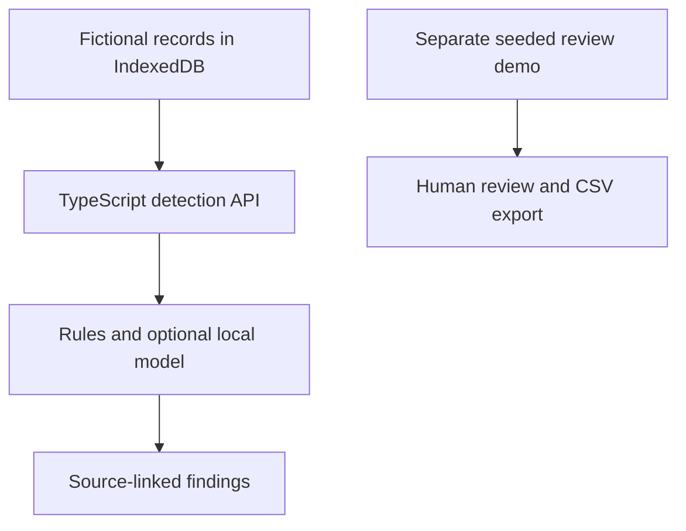

# PENCIL Bridge

**HR workflow prototype · Kyushu University QREC Venture Life Challenge**

Built during the PENCIL（株式会社ペンシル） internship in the Kyushu University QREC Venture Life Challenge 2026. This is a student prototype, not an official PENCIL product.

[Public repository](https://github.com/Jsmitty78/pencil-people-bridge) · [Live demo](https://pencil-people-bridge.vercel.app)

[Back to my profile](../README.md)

## Our ten-day build

**Employee interviews, a bilingual prototype and a final presentation — built with feedback from PENCIL’s HR and engineering teams.**

I spent 10 days working on PENCIL Bridge with **Takeshi Yamamoto** and **Sydney Magnolia Tjandra**, during our placement at **PENCIL（株式会社ペンシル） in Fukuoka** through Kyushu University’s **QREC Venture Life Challenge 2026**. I led the prototype and demo development, alongside product direction and the technical delivery.

*Working with PENCIL’s internal engineering division, two HR supervisors and an engineering director. We brought the prototype into the discussion so we could work through how it would fit the company’s workflows.*

[Try the bilingual demo](https://pencil-people-bridge.vercel.app) · [Technical walkthrough](https://github.com/Jsmitty78/pencil-people-bridge/blob/main/README.md#architecture) · [Internship record](https://github.com/Jsmitty78/pencil-people-bridge/blob/main/docs/PROJECT_ARCHIVE.md)

## What we got done in 10 days

In ten days, we went from interviewing employees about an internal communication problem to presenting a working prototype in Japanese and English. I led the build and demo, while Takeshi and Sydney brought the research, engineering support, design and business work that helped us turn the idea into something we could explain and demonstrate.

| Part of the project | What we had to show by the end |
| --- | --- |
| Understanding the problem | 10 employee interviews across HR, management, consulting and engineering. |
| Choosing what to build | Three early directions discussed with HR, then a focused workflow for reviewing work issues. |
| Building the prototype | Japanese and English screens, 10 fictional issues and 40 source records, detection with evidence, and a separate simulated review queue. |
| Working with the company | Prototype discussions with the internal engineering division, two HR supervisors and an engineering director. |
| Explaining the result | A subtitled demo, financial planning case, next-step pilot proposal and final presentation on August 29. |

## Why I went to Fukuoka

I went to Fukuoka because I wanted to challenge myself. I am usually based in Kansai, and I had never been to Kyushu before. I had no connections there; my goal was to make them. I wanted to spend my summer meeting new people, taking on a project inside a company, and seeing what I could make happen somewhere completely new to me.

PENCIL’s office stood out to me straight away. It was creative and open, and I enjoyed seeing engineers and consultants work closely together. I was excited that we could interview people, test ideas and build something during the placement.

<table>
<tr>
<td width="50%"></td>
<td width="50%"></td>
</tr>
<tr>
<td>At PENCIL in Fukuoka.</td>
<td>At Kyushu University during Venture Life Challenge.</td>
</tr>
</table>

I was on a very tight budget, so I moved between small capsule hotels and internet cafés while finding my way around the city. Eventually, friends I made there offered me places to stay. I had to be resourceful to make the trip work, but I was excited to be there, meet people and get involved in new projects.

<table>
<tr>
<td width="35%" valign="middle" align="center"></td>
<td width="65%" valign="middle"></td>
</tr>
<tr>
<td>One of the capsule hotels I stayed in while making the trip work on a tight budget.</td>
<td>A trip to a temple and its beautiful waterfall—a chance to explore Kyushu with a friend and enjoy some time outside the office.</td>
</tr>
</table>

One of my favourite memories started with meeting a family at an arcade. They were wonderful: they showed me around, treated me like one of their own and even let me stay with them for a few days. I had arrived without knowing anyone, and suddenly I had people welcoming me into their everyday lives. I am still grateful for that kindness.

*Sharing a meal with the family who made me feel so welcome.*

*Making friends and memories outside the office, too.*

I loved Fukuoka and getting to know Kyushu. Fukuoka’s startup community was welcoming, and the people I met made me want to keep exploring. During my days off, I also took a few days to travel to Kumamoto and volunteer with earthquake recovery work. I wanted to contribute while I was there, as well as experience a place I had never visited before.

*Taking time to explore Kyushu outside the project.*

I came back with a project I was proud of, new friendships and so many memories. Going somewhere without an existing network pushed me to introduce myself, ask questions and get involved. That same curiosity carried into our work at PENCIL: we needed to listen to the people inside the company before deciding what to build.

## Starting with the people doing the work

Our challenge was to understand an organisational problem involving a growing, diverse workforce and changes in how people work with AI. Before deciding what to build, we needed to hear how communication worked inside the company.

We carried out **10 interviews** across HR, management, consultants and engineers, speaking with both Japanese and international employees. We looked at where information was shared, what happened when instructions were unclear, and how HR learned about a problem after it had developed.

Doing interviews in Japanese was challenging for me. I was still learning, and I used some AI tools to help me with the language along the way. It pushed me to keep practising while listening to the concerns people were sharing. I also learned how division meetings worked inside a Japanese company by seeing how the teams communicated and discussed their work. That was an important part of the experience for me, alongside building the product.

*Interviewing an engineer, hearing his concerns and understanding how communication affected his work.*

A recurring issue was that the history of a decision could be spread across several places: a meeting, a Chatwork thread, a Backlog issue, a document in Box, or a verbal conversation. Someone investigating later might have the outcome but not the context that led to it.

*Working through the problem on the whiteboard: important information getting lost between people, languages and tools.*

That gave us a more specific question to work on: could we bring the relevant records together around an issue, show what might need clarification, and help HR follow up earlier?

## Choosing a focused product

We considered three early directions and took them to HR for feedback. The direction ranked first was organising issues between employees, managers and HR. Communication support based on needs someone had explicitly stated was also useful, but the first step was to make the situation easier to understand.

We narrowed the prototype to **HR-only review of work issues**. A finding would point back to source records and offer a neutral question to clarify. It would not score an employee, infer their personality or health, or make an employment decision.

That decision affected the interface as well as the analysis. We grouped records around a piece of work, kept the evidence visible, and separated private HR analysis from a clarification draft that would need human approval before being shared.

## Building with Takeshi and Sydney

We came from three different universities and brought different skills to the project. I was studying Computer Engineering at Ritsumeikan University, Takeshi was studying Civil Engineering at Kyushu University, and Sydney was studying Finance and Accounting at Ritsumeikan Asia Pacific University (APU). Working together meant learning how each of us approached the problem and making room for those different perspectives. I led the prototype, product direction, demo and technical delivery. Takeshi worked on employee research, engineering support, subtitles and presentation delivery. Sydney worked on design, filming, the financial presentation and presentation delivery. Between the three of us, we covered product and prototype development, user research and systems engineering, and business strategy and impact. We needed all of those parts to come together for the final presentation.

*Sydney, me and Takeshi at PENCIL: three universities and different skills, working towards the same ten-day delivery.*

There was a lot to fit into the build: understanding the interviews, choosing the scope, implementing the demonstration, getting feedback and preparing a presentation that explained both the product and the business case. The research, software and presentation had to stay connected as the idea changed.

## Bringing the prototype to HR and engineering

The review with the internal engineering division, two HR supervisors and an engineering director was an important part of the process. We had to explain how the idea would work with existing records and what HR would actually see.

*Working with HR and an engineering manager on our proposal, with PENCIL Bridge on screen.*

We took three main points from the engineering feedback and worked them into the design:

| Feedback area | What we worked towards |
| --- | --- |
| Information across tools | Link related Chatwork, Backlog and meeting records around the same issue, so the reviewer can follow the evidence. |
| HR visibility | Prepare a weekly summary and prioritised review candidates, rather than relying only on someone opening a dashboard. |
| Reasons behind a finding | Show why something was flagged, retain the source evidence and leave the final judgement with HR. |

The public prototype demonstrates those ideas using fictional records and simulated delivery. It does not connect to the company’s live systems. The engineering work included deciding what could be demonstrated during the placement and what would need approval, integration and evaluation later.

## What we could demonstrate

By the final presentation, we could show a local data-to-detection flow and a simulated HR review workflow. The example data contained **10 fictional work issues and 40 source records**, representing Backlog, Chatwork, meeting notes and Box.

The demonstration covered:

- Loading and storing fictional cases in browser-local IndexedDB.
- Detecting conflicting instructions, undocumented verbal decisions, rework signals, and acknowledgement followed by clarification.
- Returning findings with source references and neutral follow-up questions.
- Reviewing seeded cases, marking them reviewed, moving them to follow-up or dismissing a false positive.
- Keeping private HR analysis separate from a staff-facing clarification draft.
- Switching between **Japanese and English**.
- Exporting review data as CSV and showing a simulated weekly report and delivery state.

The detection lab and the seeded review queue are separate demonstration flows. New findings do not automatically enter the queue. Review states reset when the page reloads, while the detection lab retains its sample cases in IndexedDB. These details matter when someone tries the demo and follows the code.

### Inside the implementation

The repository uses **Next.js, React and TypeScript**. The detection API accepts bounded requests, applies deterministic rules and can optionally use a local Ollama model for semantic contradiction checking. The deterministic path runs without an external AI service.

The interface presents each signal as something to review, with the original evidence available. A reviewer can inspect the records and decide whether a follow-up is useful. There are no employee rankings or automatic personnel decisions.

Live workplace connectors, production authentication, access control, approved retention and external notification delivery remain outside the prototype. The [architecture and setup instructions](https://github.com/Jsmitty78/pencil-people-bridge/blob/main/README.md#architecture) explain the current implementation, and the [system-design alignment](https://github.com/Jsmitty78/pencil-people-bridge/blob/main/docs/system-design-alignment.md) records the work needed beyond the demonstration.

## Our pitch deck and product demo

**[Look through the pitch deck we designed for Kyushu University](https://github.com/Jsmitty78/pencil-people-bridge/blob/main/docs/media/deliverables/pencil-bridge-kyushu-pitch-deck.pdf)** · **[Watch our product demo with HR supervisor Hitomi-san](https://github.com/Jsmitty78/pencil-people-bridge/blob/main/docs/media/deliverables/pencil-bridge-hr-demo.mp4)**

We designed this deck as our final deliverable for **Kyushu University（九州大学）**, bringing together what we learned at **PENCIL（株式会社ペンシル）**, the interviews, our product decisions, the demo and the business case. It is the original 13-slide presentation, including the technical appendix.

The demo was part of that presentation. We tested our system with a real HR supervisor at PENCIL, Hitomi-san, and the video features her alongside the product walkthrough. I directed the video, Sydney filmed it, and Takeshi added the subtitles. You can watch the original 84-second video above; the PDF itself does not play the video embedded in the presentation.

### The ten-day MVP and what happened next

We only had ten days to build the MVP, test it with people inside the company and prepare our final delivery. For me, the project was a success because we got something working, put it in front of a real HR supervisor, and used the company’s feedback to improve it.

We helped PENCIL develop this, and the company has continued with an updated version that is still in use as of November 2026. The code and demo shared here preserve our internship MVP. The updated internal system is separate from this public version.

The deck captures our proposal at the time, including planned integrations and estimated financial benefits. The implementation details below explain what this public MVP actually supports; the financial figures remain planning estimates, not measured savings from the updated internal system.

## Presenting what we had built

Our final presentation was on **August 29, 2026, at PwC Consulting in Fukuoka**. We prepared an approximately eight-minute presentation followed by five minutes of questions. The demo video had subtitles so it did not depend on everyone being able to hear the room audio.

I handled the opening, demo introduction and transition, then the financials, roadmap, team and conclusion. Sydney presented the company context, HR challenge, validation and engineer feedback. Takeshi presented the interviews and focused features.

*Showcasing our work at PwC Japan’s Fukuoka office for the Venture Life Challenge final presentation on August 29.*

We also presented a financial planning case: **150 hours of annual HR capacity**, valued at **¥3,000 per hour**, giving **¥450,000 of estimated annual value** against a **¥150,000 investment assumption**. The resulting 3.0 benefit-cost ratio, approximately 200% ROI and four-month payback were modelled estimates. We had not measured those savings through a company rollout.

What I could show at the end of those ten days was the whole process: the people we interviewed, the problem we chose, the prototype I built with the team, the feedback from company staff, and what we would need to test next. We had a working demonstration to put alongside the presentation and financial plan.

## Finishing the program together

*Our team with the QREC banner and completion certificates at the end of the program.*

The ten-day build brought research, product decisions, implementation and presentation together. I was responsible for getting the prototype and demo working, but the direction came from the interviews, our team’s work and the feedback we received inside PENCIL.

It is the kind of work I wanted to experience when I came to Fukuoka: understand a problem with the people facing it, build something they can respond to, and use their feedback to make the next version more practical.

## What comes after the prototype

At the end of the internship, we proposed a permission-reviewed pilot using approved or anonymised cases. Our evaluation plan was to measure useful findings, false positives, HR review time and trust before expanding access or making claims about impact. That was the next-step plan for the MVP described here; PENCIL’s subsequent internal version is separate.

The full internship ran from **August 17–29, 2026**, with ten days spent on the project build described here. I have kept the demonstration, code and technical documentation in this repository so people can explore what we made and how it works. This is our student internship prototype, not an official PENCIL product or a production HR system.

## Handing it over and heading back to Kansai

We also presented PENCIL Bridge at the company’s quarterly meeting, in front of **100 employees, including the CEO**, in **both English and Japanese**. After finding the Japanese interviews challenging, being able to share our work in both languages meant a lot to me. The CEO was very impressed with what we had built and decided to start a pilot. After everything we had fitted into those ten days, it meant a lot to see the company want to take the project forward.

Unfortunately, I had to head back to Kansai for the start of my new semester. It was hard to leave when there was still more I wanted to do, especially after getting to know the team and the people at PENCIL. Before I left, I handed over all my project deliverables to the engineering team so they could continue the work.

I went to Fukuoka wanting to challenge myself and build connections from scratch. I left with new friends, a project we had taken from interviews to a working MVP, and the experience of handing it over for a company pilot. It was a great experience, and I’m grateful to everyone who made us feel welcome and helped us get there.

*With our teammates and colleagues at PENCIL—a final memory of the people who made this experience so special.*

[Explore the code and full technical details](https://github.com/Jsmitty78/pencil-people-bridge/blob/main/README.md) · [Read the original project archive](https://github.com/Jsmitty78/pencil-people-bridge/blob/main/docs/PROJECT_ARCHIVE.md) · [Photo and story sources](https://github.com/Jsmitty78/pencil-people-bridge/blob/main/docs/media/README.md)

---

## The question

How could HR organize information scattered across workplace conversations and prepare clearer follow-up questions?

Our team explored a prototype that surfaces possible missing context and conflicting information for human review. The goal was to help someone investigate an issue, not to score employees or automate personnel decisions.

## My contribution

I worked on product direction, prototype implementation, and the technical demonstration. I helped translate research and feedback into a bilingual interface with source-linked findings and a review workflow. PENCIL engineers and HR tried the prototype, and their feedback informed improvements to the workflow and presentation.

## Technical work

The prototype uses Next.js, React, and TypeScript. A detection screen stores fictional records in IndexedDB and sends bounded requests to a typed API. The API combines explicit rules with optional local Ollama analysis, then returns findings with evidence references and follow-up questions.

### Decisions that mattered

- **Bounded inputs and a timeout:** keep a malformed or slow request from making the demonstration unusable.
- **Deterministic fallback:** preserve a basic analysis path when the local model is unavailable.
- **Source references:** let a reviewer inspect the records behind a suggested issue.
- **Browser-local fictional data:** demonstrate the workflow without connecting to company systems.
- **Human review:** support follow-up and dismissal rather than treating a model output as a decision.

## What the prototype does and does not connect

The detection screen and the seeded review queue are separate demonstration flows. Detected findings do not automatically populate the review queue. The review interface supports state changes and CSV export; report sending is simulated.

Live workplace connectors, authentication, production delivery, and deployment governance are outside this prototype. Describing these boundaries is part of the engineering work.

## What I learned

An internal tool needs a clear place in an existing workflow. Useful questions, traceable evidence, and a familiar export can matter more than adding another dashboard.

## Team and field evidence

| Contributor | Contribution |
|---|---|
| Jake Smith | Product direction, prototype implementation, technical demonstration |
| Sydney Magnolia Tjandra | Design, filming, financial presentation support, presentation delivery |
| Takeshi Yamamoto | Employee research, engineering support, subtitles, presentation delivery |

My [internship post and 12-photo gallery](https://www.linkedin.com/feed/update/urn:li:activity:7506581096713752577/) document the two-week internship, employee interviews, feedback from PENCIL engineers and HR, and presentations at Kyushu University and PwC Japan in Fukuoka.

## A two-minute review

1. Open the public demo and select English or Japanese.
2. Open an example in the review queue.
3. Compare the source records and the conflicting instructions.
4. Review the proposed clarification question; choose follow-up, reviewed, or false positive.
5. Inspect CSV export and the simulated weekly report.

The stored-data detection lab is separate from the seeded review queue in the inspected source. That distinction matters when evaluating the demo.
