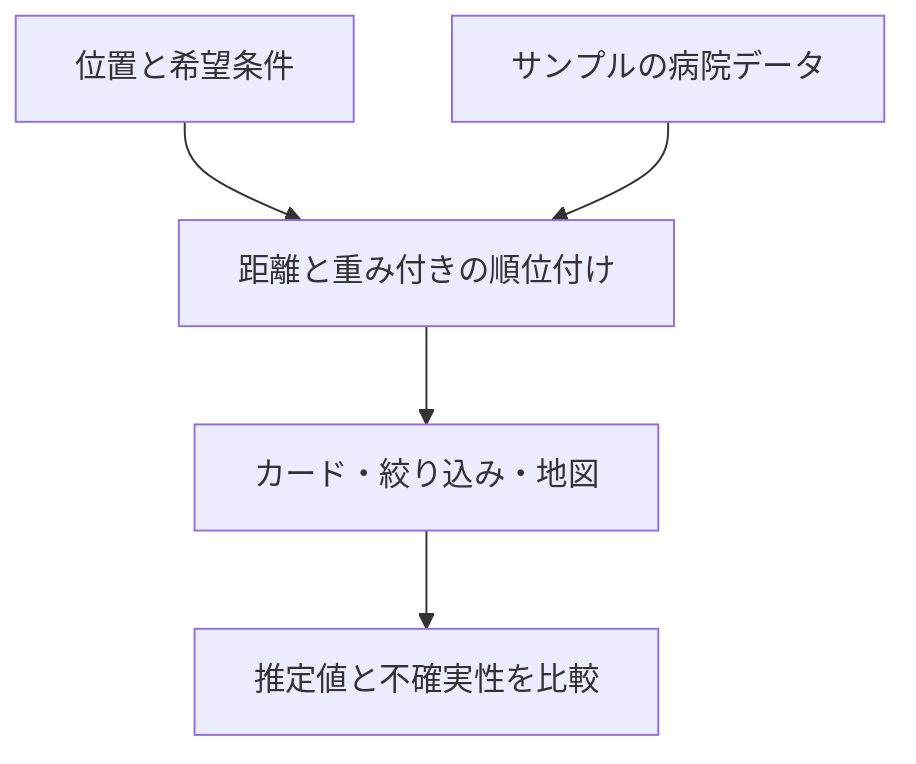

<a href="hospital-finder.md">English</a> | <strong>日本語</strong>

# Hospital Finder / CarePath Navigator

**PBL3 · 立命館大学 · プロジェクト管理とソフトウェア開発**

[プロフィールへ](../README.ja.md) · [公開フロントエンド](https://github.com/daitera1/PBL3-Group-D/tree/add-carepath-frontend/frontend/route-to-care-ai) · [チームの技術資料](https://daitera1.github.io/PBL3-Group-D/)

**概要：** 7人のチーム · アンケート回答89件 · プロジェクト管理、フロントエンド、アーキテクチャを担当。

[操作できるプロトタイプを開く](https://route-to-care-ai.lovable.app)

## 取り組んだ課題

病院選びでは、地図で最も近い場所を探すだけでは足りません。授業のプロジェクトとして、距離、推定待ち時間、対応言語、診療分野を一つの画面で比較する方法を考えました。チームでは89件のアンケート回答を集め、医療従事者へのインタビューも行いました。

## 私の役割

プロジェクトマネージャーとして開発を調整し、チームの担当を整理しました。フロントエンドの大部分とバックエンドの一部にも取り組みました。また、状態図・シーケンス図などのシステム設計資料と、最終デモの準備を担当しました。

## 要件から画面へ

位置の指定、病院の絞り込み、順位付きの検索結果、地図での比較に対応しています。カードには推定待ち時間とその不確実性を表示し、施設を比較するための情報をまとめました。

確認したポートフォリオ版はReact 19、TypeScript、TanStack Start/Router、Tailwind、Leaflet、Rechartsを使っています。病院情報と待ち時間の予測値はサンプルデータで、時間帯別の予測も決まった計算によるデモ用の曲線です。稼働中の予測サービスは呼び出していません。

## 技術上の判断

| 判断 | 理由 |
|---|---|
| 病院データ・順位付け処理を画面部品から分離 | 地図の表示とは独立して、順位付けの動作を確認できる。 |
| Haversine式による距離計算と希望条件の重み付け | 近さに加え、待ち時間、混雑、言語、診療分野を比較に含められる。 |
| 推定値の不確実性を表示 | 予測を、保証された待ち時間のように見せないため。 |
| 状態図・シーケンス図 | 統合作業の前に、操作とシステムの責任範囲をチームで共有できる。 |

### 実装の案内

- `src/lib/hospitals.ts`：サンプルデータ、距離計算、順位付け、デモ用予測。
- `src/routes/index.tsx`：絞り込みと比較の流れ。
- `src/components/HospitalCard.tsx`：病院情報と不確実性の表示。
- `src/components/LeafletMap.tsx`：操作できる地図。
- `src/components/LocationPicker.tsx`：位置の入力。

チーム全体の設計には、Flaskサービス、リレーショナルデータベース、XGBoostによる待ち時間モデルも含まれます。それらと、この実行可能なフロントエンド版は別です。最終報告書にはモデルの評価がありますが、ここでは学習データ、ノートブック、モデルを公開していないため、同じ評価を再現できる状態ではありません。

## チームの担当

リポジトリには次の担当が記録されています。開発は共同で行っており、各部分を一人だけで作ったという意味ではありません。

| メンバー | 記録されている担当 |
|---|---|
| Jake Smith | プロジェクト管理、状態図・シーケンス図、上記のフロントエンド・バックエンド開発 |
| Bien Alolod | ユースケース図・アクティビティ図、資料作成 |
| Mahiro Ueda | クラス図、資料作成 |
| Ibuki Yasuda | コンポーネント図、資料作成 |
| Sadia Islam | Webサイトの調整 |
| Daisuke Terauchi | Webサイトの調整 |
| Hanz Ranen | Webサイトの調整 |

## 学んだこと

プロジェクト管理の重要性を感じたのは、それぞれの作業をつなぐ部分でした。データ形式をそろえ、資料の担当を決め、最後に一つの操作の流れとして成立させる必要がありました。設計図を明確にしたことで、個別のタスクをチーム共通の実装計画につなげられました。

チームは`add-carepath-frontend`ブランチで[フロントエンド版](https://github.com/daitera1/PBL3-Group-D/tree/add-carepath-frontend/frontend/route-to-care-ai)を公開しています。[チームのリポジトリ](https://github.com/daitera1/PBL3-Group-D)から、プロトタイプと資料を確認できます。学習データとモデルはこの公開版に含まれないため、このページではモデル性能を独立して再現できたとは述べていません。

## デモの見方

1. 位置を指定し、近くの病院をカードと地図で比較します。
2. 言語や診療分野の条件を変え、順位の変化を確認します。
3. 最寄りの施設が必ず最適とは決めず、距離と推定待ち時間を比較します。
4. 不確実性の表示と、サンプルデータを使うデモであることを確認します。

自分にとって大切な条件を比較でき、その情報の不確実性も伝わること。それを画面の中で実現したいと考えました。
