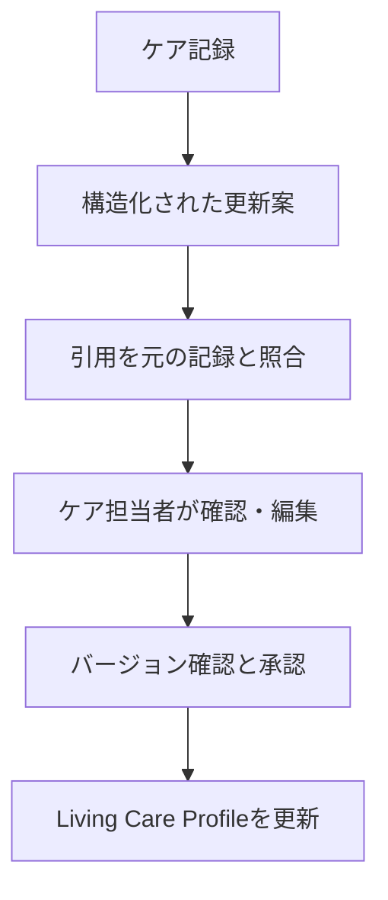

<a href="memorypath.md">English</a> | <strong>日本語</strong>

# MemoryPath

**ケアの申し送りを、人が確認・承認できるAIで支える**

**YC Request for Startupsのテーマをもとに開発 · 関西のTranspose Platform AI Hackathon**

[プロフィールへ](../README.ja.md) · [ソースコード](https://github.com/Jsmitty78/MemoryPath) · [技術ガイドとテスト](https://github.com/Jsmitty78/MemoryPath/blob/main/docs/ENGINEERING.md)

## プロジェクトについて

MemoryPathは、SOAP形式の記録（主観的情報・客観的情報・評価・計画）、介護者の観察、家族からの思い出をもとに、認知症ケアのLiving Care Profileを更新するための提案を作成します。提案には根拠となる記録を付け、看護師が引用元を確認し、内容を編集・承認してからプロフィールに反映できるようにしました。

Yu Yoshimutaと一緒に取り組みました。私はフロントエンド開発、現場調査、ユーザーインタビュー、介護者のニーズを操作の流れに落とし込む部分を担当しました。現在のリポジトリにはハッカソン後の開発も含まれるため、公開されているすべての機能を当日の成果として紹介しているわけではありません。

## ハッカソンでの開発

2026年7月5日に関西で開催された**Transpose Platform × 立命館大学 × OUVC c0mpiled**で開発しました。**Y CombinatorのCEO、Garry Tan氏**による講演と質疑応答の後、**YC Request for Startups**のテーマに沿って5時間で試作するイベントでした。

課題選びからAIを使った短時間の試作まで、その場で取り組む形式でした。仕様、設計、実装、QAを進めるツールとしてGStackとGBrainが紹介されました。私たちは「看護師がケア記録の重要な変化を見つけながら、その根拠も確認できるようにするにはどうすればよいか」という問いに絞りました。

[公式イベント案内とプログラム](https://luma.com/compiled-4qzo)

*プロトタイプの画面。リポジトリでは合成データを使用しています。*

## 確認・承認の流れ

## 実装していること

現在のコードはNext.js、React、TypeScript、OpenAIの構造化出力、Zodを使用しています。提案の引用を元の記録本文と照合し、未承認の提案と承認済みのプロフィール更新を分けています。

| 技術上のポイント | 実装 |
|---|---|
| モデルの構造化出力とスキーマ検証 | [profile-agent.ts](https://github.com/Jsmitty78/MemoryPath/blob/main/src/lib/profile-agent.ts) |
| 引用の正規化と、裏付けのない根拠の除外 | [verify.ts](https://github.com/Jsmitty78/MemoryPath/blob/main/src/lib/verify.ts) |
| 承認した変更を適用する前のバージョン確認 | [approve.ts](https://github.com/Jsmitty78/MemoryPath/blob/main/src/lib/approve.ts) |
| 提案を編集できる確認画面 | [ProposalReview.tsx](https://github.com/Jsmitty78/MemoryPath/blob/main/src/components/ProposalReview.tsx) |
| 画面から確認できる根拠 | [EvidenceList.tsx](https://github.com/Jsmitty78/MemoryPath/blob/main/src/components/EvidenceList.tsx) |

実行時には、構造化出力を返すモデルを直接呼び出します。コード内にエージェント設定があることだけを理由に、マルチエージェントシステムとは説明していません。

## GStack・GBrainとケア情報の扱い

**GStack**はイベントで紹介されたAI開発支援ツールです。**GBrain**はMemoryPathで任意に使える検索バックエンドです。ケア記録をMarkdownに書き出し、brainに取り込んで検索し、提案の文脈として利用します。`CAREOS_MEMORY_BACKEND=gbrain`で有効にでき、通常のワークフローはGBrainなしでも動作します。

GBrainを通じて、関連するケア情報をつなぐナレッジグラフの考え方を探っています。アプリ自体に独自のグラフデータベースやグラフ可視化機能を実装したものではなく、記録の検索と根拠付きのプロフィール更新を実装しています。SOAP記録は本文として保存し、4つの臨床項目へ自動分解するものではありません。

[GBrainアダプター](https://github.com/Jsmitty78/MemoryPath/blob/main/src/lib/gbrain.ts) · [提案ワークフロー](https://github.com/Jsmitty78/MemoryPath/blob/main/src/lib/proposal.ts)

## この開発で学んだこと

人による確認は、画面の中で実際に機能する必要があります。根拠が見えること、提案を編集できること、承認の操作があることが重要でした。AIの回答の下に「人が確認してください」と書くだけでは足りないと感じました。

合成記録とローカル保存を使うプロトタイプです。医療現場に導入済みのシステムではなく、認証や本番運用のための保護機能には追加の開発が必要です。
