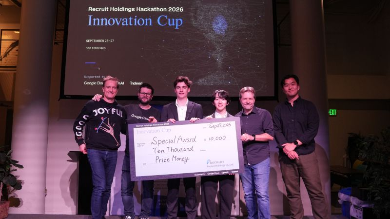
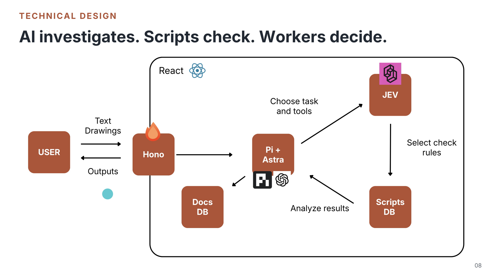
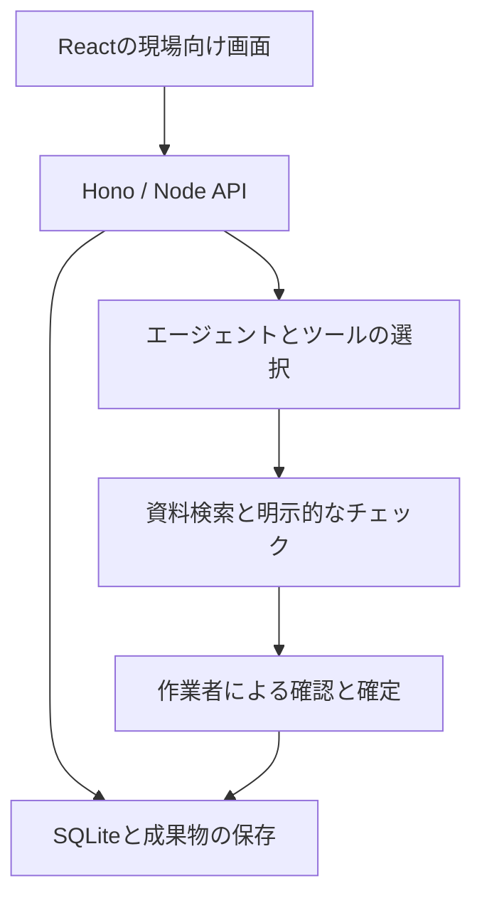
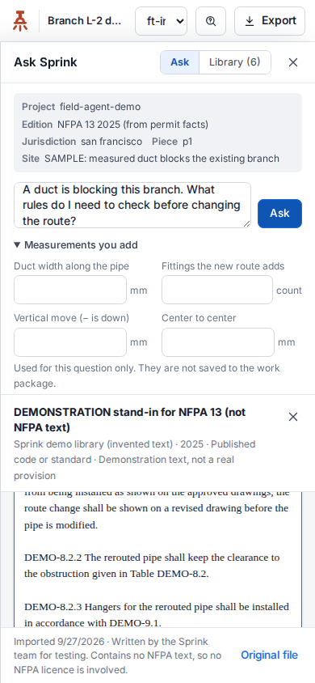

<p align="right"><a href="sprink.md">English</a> | <strong>日本語</strong></p>

# Sprink

**特別賞 · チーム賞金10,000米ドル · Recruit Holdings / Indeed Innovation Cup · サンフランシスコ**

**Yu Yoshimuta・Jake Smith · 2026年9月25〜27日**

Yuと私は48時間でSprinkを開発し、チームで**10,000米ドルの特別賞**を受賞しました。その後もプロダクトと技術面の開発を続けています。

[プロフィールへ](../README.ja.md) · [コードとテスト](../docs/ENGINEERING_REVIEW.ja.md#start-with-sprink) · [フロントエンドテスト38件の実行手順](../docs/VERIFICATION.ja.md) · [写真付きの全編ストーリー](https://github.com/Jsmitty78/SprinkMate/blob/main/docs/PROJECT_STORY.ja.md) · [ローカルで起動](https://github.com/Jsmitty78/SprinkMate/blob/main/README.ja.md)



*48時間の開発を終え、サンフランシスコの授賞式で撮ったチーム写真。[当時のLinkedIn投稿](https://www.linkedin.com/feed/update/urn:li:activity:7514156363523076096/)より。*

## 現場の話から始める

スプリンクラー施工者とホテルの設備管理エンジニアに、普段の仕事について話を聞きました。そこから、必要な規定を探すこと、作業に必要な材料を準備すること、障害物によって現場の条件が変わったときに計画を見直すことの3つを、試作の中心に据えました。

現場の質問に対して、根拠と次の作業案を示し、作業者自身が確認できるツール。それがSprinkになりました。ピッチデックには、初期の有料テストとして月額20ドルの契約3件を記録しています。これは最初の購入の実績であり、継続利用や生産性の改善を測定した結果ではありません。

## 開発の流れ

| 段階 | 取り組んだ内容 |
|---|---|
| 課題の調査 | 現場へのインタビューを行い、施工者の次の作業に焦点を絞る |
| コンペでの開発 | 参照資料の検索、材料の準備、現場変更のデモ |
| 発表 | 動くプロトタイプと、現場の声を実装につなげたピッチ |
| イベント後 | モバイルの質問操作、確認してから送信する音声入力、出典の文脈、キャンセル、失敗時の表示 |

後から行った改善と、コンペ中の48時間の開発は区別しています。

## 審査員からのフィードバック

**Indeed CTOのJim Giles氏**から技術面の助言を、**Glassdoor共同創業者・元CEOのRobert Hohman氏**から事業を進めるための助言をいただきました。**Google CloudのDamien Contreras氏**、**OpenAIのHo Joon Cha氏**からも意見をいただきました。

4人の審査員への発表では、実装だけでなく事業についても話し合えました。ここで紹介するのはイベントでのフィードバックであり、製品への推薦を意味するものではありません。

[イベントと公表された賞の区分](https://innovation-cup2026.devpost.com/) · [私のイベント記録](https://www.linkedin.com/feed/update/urn:li:activity:7514156363523076096/)

## 私の担当

顧客調査、プロダクトの方向性、操作の流れの設計、検証、ピッチ、プロダクト開発に取り組みました。その後のコードでは、モバイルのAsk画面、ブラウザー音声入力とテスト、時間・入力範囲を制限したAPIリクエスト、プロバイダーのエラー処理を担当しました。

Yu Yoshimutaは、主要な統合処理、計画機能、ワークフローの実装に大きく貢献しました。以下のアーキテクチャは、チーム全体のシステムを示しています。

## システムの構成



*ピッチデックの構成図。Docs DBは参照資料のライブラリ、Scripts DBは検証ルールのカタログを表しています。*



ピッチでは役割分担を**「LLMが調べ、スクリプトが確認し、作業者が決める」**と説明しました。自然言語による調査、資料検索、決められたルールによる検証、人の承認には、それぞれ別の役割があります。ピッチで説明した判定・検証機能のすべてを、イベント中に実装したわけではありません。

## 技術面で見ていただきたいところ

| 項目 | 実装の考え方 |
|---|---|
| 音声入力 | 認識結果は編集できる質問欄に入り、確認してから送信します。権限拒否、無音、未対応ブラウザーを分けて表示します。 |
| ネットワーク | 待ち時間の制限、キャンセル、明確なエラー表示により、待ち続けたり、プロバイダーの失敗を回答として見せたりしないようにします。 |
| 根拠 | 資料カードで文書の文脈と出典を示し、表示上の制約を守ります。 |
| 古い結果 | リビジョンを確認し、古い入力や結果を新しい作業状態に適用しないようにします。 |
| 人の判断 | 寸法や経路変更案は、明示的な確認を経て確定します。 |

## 画面で見る



*モバイルAskのデモ。表示されている参照情報は説明用の架空データで、実際のNFPAの指針ではありません。*

冒頭の受賞写真は、開発から最終発表までをつなぐ記録です。画面と構成図の出典は[画像の説明](../assets/sprink-media.md)にまとめています。

## 担当した実装の一例

ブラウザーの音声入力コントローラーでは、エラーを画面の状態に変換しています。マイクの許可を拒否した場合、キャンセルした場合、話したものの認識できなかった場合では、必要な案内が異なります。

```typescript
export function statusForError(code: string): DictationStatus {
  switch (code) {
    case "not-allowed": return "denied";
    case "no-speech": return "no_speech";
    case "service-not-allowed": case "network": case "language-not-supported":
      return "unavailable";
    case "aborted": return "cancelled";
    default: return "failed";
  }
}
```

[型付きのコード抜粋を見る](sprink-speech-example.ts)。私が音声入力に取り組んだ際の`sprink/apps/web/src/workbench/ask/speech.ts`から抜粋しています。コントローラー全体ではなく、録音・認識、内容確認、送信、終了処理は別々の役割です。

## 学んだこと

現場で役立つ画面は、回答が得られないとき、マイクが使えないとき、質問を変更したときにも扱いやすい必要があります。成功した回答を出すことと同じくらい、その状態を分かりやすくすることが大切でした。

次に確かめたいのは、継続的な現場利用です。作業者が根拠を確認し、エラーから復帰し、適切な次の作業に進めるかを見ていきます。このプロトタイプは、専門家による法規・規定の確認に代わるものではありません。

## コードを見る

Yu Yoshimutaの`my-name-is-yu/InnovationCup`をもとにした[アプリケーションの公開スナップショット](sprink-source/)を確認できます。

| 確認する箇所 | コード |
|---|---|
| モバイルAsk画面 | [AskPanel.tsx](sprink-source/sprink/apps/web/src/workbench/ask/AskPanel.tsx) |
| 内容を確認できる音声入力 | [speech.ts](sprink-source/sprink/apps/web/src/workbench/ask/speech.ts) |
| バックエンドAPI | [api.ts](sprink-source/sprink/apps/server/src/api.ts) |
| エージェントの処理 | [runner.ts](sprink-source/sprink/packages/workflow/src/runner.ts) |
| 計画と選択 | [selection.ts](sprink-source/sprink/packages/planning/src/selection.ts) |
| テスト | [サーバーテスト](sprink-source/sprink/apps/server/test/) |

このスナップショットには、コミット`7efa012b2e15f433aa39bba0fcbafeac04399d9f`時点のソース、テスト、設定、技術資料を収録しています。コンペ後の開発も含みます。チームの担当と元ファイルのハッシュを保存しています。

参照PDF、資料から作成した図面データセット、一部のバイナリーのテスト素材は含めていません。**このスナップショットでアプリ全体をビルドするには、省略したデータセットが必要です。** 一部のテストにも省略した素材が必要です。別に用意した公開検証用の構成なら、それらを使わずに既存のフロントエンドテスト38件を実行できます。ただし、アプリ全体をビルドするものではありません。[ソースのREADME](sprink-source/)にコマンド、出典、除外項目を記載しています。現在のSprinkMateの起動方法は[開発リポジトリ](https://github.com/Jsmitty78/SprinkMate/blob/main/README.ja.md)から確認できます。
